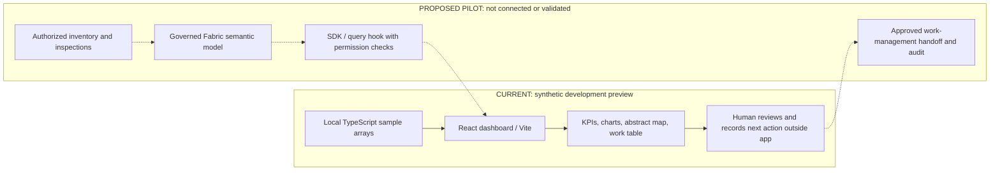

```text
             /\                 /\                 /\
            /**\      /\       /**\      /\       /**\
           /****\    /**\     /****\    /**\     /****\
          /******\  /****\   /******\  /****\   /******\
             ||       ||       ||       ||       ||
       +------------------------------------------------+
       |             C A N O P Y   O P E R A T I O N S  |
       |         See the forest. Prioritize the work.   |
       +------------------------------------------------+
              INVENTORY  -->  CONTEXT  -->  ACTION
```

# Canopy Operations — accelerator readiness package

An urban-tree inventory **visual mockup** for conversations about maintenance prioritization and reusable Microsoft Fabric analytics experiences.

> **Scope matters:** despite this repository's liquor-distribution name, its implemented application is an urban-forestry dashboard. It does not implement liquor inventory, replenishment, or distribution workflows. No customer sponsorship, deployment, Microsoft endorsement, or catalog acceptance is claimed.

## 1. Accelerator readiness summary

| Item | Assessment |
| --- | --- |
| Build name | Canopy Operations |
| Repository | https://github.com/VeVarunSharma/bc-liquor-distribution-branch-fabric-demo |
| Hosted demo | None verified; local setup below |
| Target customer/account | Reusable / cross-industry asset-operations pattern; demonstrated with municipal forestry |
| Industry | Public sector / urban forestry; other asset-intensive industries require adaptation |
| Primary persona | Urban-forestry operations manager; secondary: data engineer, SE/CSA, account team |
| Desired readiness | Not supplied; use demo-ready as the first gate, then field-ready and catalog-ready |
| Current rating | **Prototype / visual mockup. Not yet verified demo-ready, field-ready, or catalog-ready.** |

### Top three fixes before sharing

1. **Confirm the story and account.** Decide whether to retain forestry or build an actual liquor-distribution experience. Obtain approval before using a customer's name, branding, data, or implied outcomes.
2. **Prove repeatable execution and capture evidence.** Restore access to the locked package feed, run the existing checks, rehearse from a clean checkout, and capture the screenshot/video set below. A build is not proof of a working Fabric deployment.
3. **Close the action and submission gaps.** For an interactive-demo claim, implement and test the currently decorative controls; for a mockup, explicitly disclose them. Assign an owner, validate embedded authentication/deployment, and reconcile the metadata draft with the actual catalog schema.

### Evidence and boundaries

Reviewed on **2026-10-18**:

- The dashboard renders local arrays from `tree-inventory-app/src/data/demo-tree-inventory.ts`. There is no live semantic-model query in the displayed dashboard.
- Implemented: inventory metrics, health trend, condition visualization, abstract district map, species bars, maintenance table, and theme toggle.
- **Not implemented:** tree search/filtering, date selection, Export, View work plan, task assignment, write-back, dispatch, or a persisted outcome. Their visible controls must not be demonstrated as functional.
- All metrics, changes, dates, and “Inventory refreshed 8 minutes ago” text are fixed examples, not current observations or validated calculations. Species bar widths are relative to the largest displayed species, not percentages of all trees. The map is illustrative, not GIS.
- The Fabric profile is empty; Rayfin configuration enables auth and static hosting but disables data and storage. SDK scaffolding is not an end-to-end integration.
- `npm ci --ignore-scripts` failed with `ENOTFOUND` for `ms-feed-12.pkgs.visualstudio.com`. Lint and test attempts could not find their executables; the build attempt could not resolve the unavailable CLI. **No passing runtime, lint, test, build, or screenshot result is claimed.** The lockfile was not rewritten.
- The supplied [Accelerator Catalog](https://github.com/mcaps-microsoft/accelerators-catalog) returned HTTP 404 to the repository API in this session. Its schema, contribution process, and required vocabulary could not be verified. `accelerator.yaml` is a proposal, not a validated submission.

## 2. Customer story

Urban-forestry operations managers need to decide where limited inspection and maintenance capacity will have the greatest impact. Inventory, tree condition, and upcoming work can be difficult to consider together, making it harder to explain priorities to field teams and budget owners. Canopy Operations puts those perspectives in one visual experience so a manager can discuss the areas and work items that deserve attention. This synthetic mockup helps a customer validate the decision workflow before investing in trusted data integration or dispatch automation; it does not demonstrate measured savings or a completed field operation.

## 3. End-to-end journey

The current end-to-end **conversation** ends in a human-owned next action; an automated operational journey remains pilot scope.

1. **Request:** the manager asks, “Which tree inspection should we discuss first, and what supports that decision?”
2. **Inputs:** open the fixed sample inventory, five district summaries, six monthly health points, species counts, and four work items. No upload, prompt box, or live ingestion is involved.
3. **Context:** review 12,846 example trees, 82% healthy canopy, 148 priority work items, and the sample district health values. Explain that these are independently authored presentation fixtures, not reconciled operational measures.
4. **Workflow:** compare the health trend and district context, then review the maintenance table. Central streets has the lowest displayed district health (74) and a critical risk-inspection example; this suggests a discussion, not a computed causal recommendation.
5. **Output:** identify `TR-10482`, Western redcedar, Central streets, “Risk inspection,” due “Today,” as the example to validate with the customer. “Today” is static sample text.
6. **Next action:** outside the app, record the proposed inspection, accountable person, and validation question in the customer's approved work-management process. Do not click View work plan and claim a dispatch occurred.
7. **Pilot extension, not delivered:** connect authorized inventory/inspection data through a governed semantic model, reconcile measures, validate permissions, and add an approved handoff or write-back with audit evidence.

## Quick start — local synthetic preview

Prerequisites: Git, Node.js 22.22.2 or a compatible newer runtime, npm, and network access to **all registries referenced by the lockfile**. Node 24.21.0 was available in this session, but installation was blocked. A Fabric tenant, Azure login, Copilot CLI, and global Playwright installation are not required by the local development rendering path.

From this task's checkout:

```bash
cd /home/runner/work/bc-liquor-distribution-branch-fabric-demo/bc-liquor-distribution-branch-fabric-demo/tree-inventory-app
npm ci --ignore-scripts
npm --ignore-scripts run dev -- --host 127.0.0.1
```

For another checkout, use its absolute `tree-inventory-app` directory instead. Open the localhost URL printed by Vite (normally `http://127.0.0.1:5173`). The `--ignore-scripts` setting skips the Rayfin `predev` hook for this local-only preview; development mode bypasses embedded auth in the existing entry point. **This is not the production security model.** Keep the dev server loopback-only and use no customer data.

Expected preview: Canopy Operations heading, Synthetic demo badge at desktop width, four KPI cards, charts, district illustration, and maintenance table. Toggle the theme. Stop with Ctrl+C. Until installation succeeds and these checks are observed, treat the preview as unverified.

### Existing quality commands

After a successful install, from the same application directory:

```bash
npm run lint
npm test
npm run build:fabric
```

`build:fabric` runs config generation, TypeScript with `--noCheck`, and Vite without the `prebuild` lifecycle hook used by `npm run build`. It does **not** establish full type-check coverage. Keep the generated third-party notices when distributing a build. Do not let `npx` download substitute tooling if installation failed; resolve the locked dependency installation first.

### Deployment guide — gated Fabric path

1. Have the platform owner confirm Fabric Apps/Rayfin availability, supported tenant/region, workspace permissions, licensing, and expected hosting costs. None were verified here.
2. Install the locked tooling successfully. With an authorized operator, inspect the installed Rayfin CLI help and follow its supported provisioning process. The existing auth service directs operators to `npx rayfin up`; no provisioning or deployment was run in this task.
3. Configure the deployment's `VITE_RAYFIN_API_URL`, `VITE_RAYFIN_PUBLISHABLE_KEY`, `VITE_FABRIC_WORKSPACE_ID`, `VITE_FABRIC_ITEM_ID`, and `VITE_FABRIC_PORTAL_URL` through the approved environment mechanism. `VITE_*` values are client-visible: never put a secret, access token, or private key there.
4. Review `rayfin/rayfin.yml`: it specifies `dist` static hosting and `npm run build:fabric`. Build and publish only through a platform-approved process; do not assume uploading `dist` to an arbitrary static host will work.
5. Open the artifact inside Fabric and verify authorized sign-in, denied/unauthorized access, theme behavior, and browser/network errors. Production calls embedded auth at startup; an ordinary `npm run preview` without configuration is not a supported standalone demo.
6. Record the deployment owner, environment, exact commands used, required permissions, smoke-test evidence, rollback, and cleanup procedure before declaring field-ready. For rollback, redeploy the last verified artifact via that platform process; remove pilot artifacts and grants with the workspace owner after the pilot.

Live data integration is a separate change: the dashboard currently consumes only sample arrays. Do not register a semantic model and assume the visuals are connected.

### Troubleshooting and support

| Symptom | Next step |
| --- | --- |
| `npm ci` reports feed DNS/access errors | Ask the package-feed/network owner to restore approved access to the exact lockfile host; do not disable TLS, embed credentials, or silently replace dependency versions. |
| `eslint`, `vitest`, or the Fabric CLI is missing | Complete installation before retrying quality commands. |
| Rayfin predev requires environment setup | Use the documented local-only preview command for synthetic review; use provisioned configuration for Fabric. |
| Built app fails at startup or says it must be embedded | Verify the five client-visible environment values and open it through the configured Fabric artifact. |
| Search, Export, date, or work-plan control has no effect | Expected current mockup limitation, not a demonstrated integration. |

Use [repository issues](https://github.com/VeVarunSharma/bc-liquor-distribution-branch-fabric-demo/issues) for non-sensitive defects: include commit, Node/npm versions, reproduction steps, and sanitized logs. No SLA or support owner has been established. The inherited [security policy](tree-inventory-app/SECURITY.md) references Microsoft's reporting process; confirm a reporting route appropriate to this repository's ownership before external release. Never post vulnerabilities, credentials, or customer records in a public issue.

## 4. Demo experience

### Five-minute flow

| Time | Presenter action | Value / boundary |
| --- | --- | --- |
| 0:00–0:45 | State the manager's prioritization question and synthetic/mockup scope. | Establish the customer decision, not a product claim. |
| 0:45–1:45 | Walk through inventory, health, and priority-work cards. | Discuss capacity and condition; do not claim verified carbon or savings. |
| 1:45–2:45 | Compare health trend and district illustration. | Show context; explain there is no live refresh or GIS service. |
| 2:45–4:00 | Review the critical `TR-10482` maintenance row. | Identify an example next inspection; do not imply task creation. |
| 4:00–5:00 | Summarize the manual next action and invite a discovery session. | Agree a data owner and decision to test. |

### Fifteen-minute flow

| Time | Presenter action / discussion |
| --- | --- |
| 0:00–2:00 | Confirm persona, today's prioritization process, and limits of the sample. |
| 2:00–5:00 | Review KPIs and ask which measures the customer trusts and how they are defined. |
| 5:00–8:00 | Review health trend, districts, and species; identify missing context and data-quality risks. |
| 8:00–11:00 | Walk the maintenance example through the customer's existing approval and work-order process verbally. |
| 11:00–13:00 | Show theme toggle and architecture below; distinguish current local rendering from proposed Fabric integration. |
| 13:00–15:00 | Agree a pilot district, access constraints, measurable acceptance criteria, sponsor, and next meeting. |

### Screenshot and video asset brief

**Capture is blocked by dependency installation. No screenshots or video have been fabricated or checked in.** Capture from the successfully running app, not from an illustration or rewritten HTML.

| Planned asset | Capture instructions | Acceptance |
| --- | --- | --- |
| `assets/screenshots/overview-light.png` | Desktop, 1440×1000, light theme; heading and KPIs | Legible, synthetic label visible, no browser identity or tenant information |
| `assets/screenshots/overview-dark.png` | Same viewport after theme toggle | Same data and clear text contrast |
| `assets/screenshots/maintenance.png` | Scroll to the four-row maintenance table | Critical example and table headers readable |
| `assets/screenshots/mobile.png` | 390×844 viewport | Check clipping and horizontal table navigation; report issues rather than implying validation |
| Five-minute narrated recording | Follow the short script with captions/transcript and a scope disclosure | No credentials, customer data, unsupported clicks, or claim of a completed dispatch |

Demo success means a viewer can explain the persona, identify the sample critical inspection and its context, distinguish synthetic from live data, and name the human next action. A facilitator must first prove clean setup, error-free rendering, and theme switching. A customer outcome is a hypothesis until validated in a pilot.

## Architecture — current versus proposed



The production entry point contains a Fabric embedded-auth gate, but that path has not been exercised here. No backend, storage, automatic scheduling, or model-driven recommendation is provided by the current dashboard.

## 5. Reusability assessment

| Area | Reuse / customization / hygiene |
| --- | --- |
| Visual shell | Reuse responsive cards, charts, table, design tokens, and theme support; validate accessibility and small screens before release. |
| Sample fixtures | Reuse the typed fixture structure for isolated presentations. Counts, trends, dates, units, and definitions must be customized and reconciled before analytical claims. |
| Semantic-model scaffolding | Reuse the query hook and table adapter as starting points, not a preconfigured forestry model. No model, ingestion pipeline, DAX dashboard queries, or infrastructure template is delivered. |
| Account-specific adaptation | Customize vocabulary, asset taxonomy, geography, risk criteria, branding, approved measures, data access, and work-order handoff. Liquor-distribution reuse needs a new customer story and actual business workflow. |
| Anonymization | Keep synthetic fixtures for public sharing. Remove real asset/location identifiers, tenant/workspace/item IDs, environment files, exports, browser profiles, screenshots with identities, and account references unless approved. |
| Templates to extract | Use these README sections as discovery/demo/runbook templates; promote sample interfaces into a documented data contract, the diagram into an architecture pattern, and validated quality commands into a root CI workflow. These extractions are future work. |

### Source map

- `tree-inventory-app/src/components/tree-inventory-dashboard.tsx`: visible experience.
- `tree-inventory-app/src/data/demo-tree-inventory.ts`: presentation data and interfaces.
- `tree-inventory-app/src/main.tsx`: development versus embedded-auth startup.
- `tree-inventory-app/src/hooks/use-semantic-model-query.ts`: unused-by-this-dashboard query scaffolding.
- `tree-inventory-app/fabric.yaml`: empty default connection profile.
- `tree-inventory-app/rayfin/rayfin.yml`: auth/static-hosting intent.
- `tree-inventory-app/AGENTS.md`: inherited development guidance; some statements describe the starter, not this implementation.

The app has an [MIT license](tree-inventory-app/LICENSE). Review inherited copyright, conduct, security, and third-party notices before redistributing; metadata in this package does not expand those rights.

## 6. Customer engagement motion

**Account-team opener:** “How does your operations team decide which assets need attention first? We have a synthetic visual example that brings inventory, condition, and upcoming work together so we can test whether that decision workflow fits your team before connecting your data.”

**Discovery questions**

1. Who owns prioritization, who approves it, and who performs the work?
2. Which decision is slow or difficult today, and what is the current baseline?
3. Where do inventory, inspection history, and work orders live? Who can authorize access?
4. What does “critical” mean, and which factors must a human verify?
5. How fresh must data be, and how are missing, duplicated, or disputed records handled?
6. Which roles, location restrictions, retention rules, and audit obligations apply?
7. Where must the approved next action land, and who owns that integration?
8. Which sponsor will judge the pilot, and what evidence would justify continuing?

**Workshop proposal:** convene the operations lead, field representative, data owner, and platform/security owner. Map one decision and its current handoffs, review this mockup, agree authoritative fields and measures, and produce a bounded pilot backlog, access decision, and signed acceptance criteria. Do not connect customer data during discovery without authorization.

**Pilot proposal:** start with one approved district and a read-only dataset in a customer-controlled environment. Validate measure reconciliation, role access, freshness, and a human-approved handoff before considering write-back. Exclude autonomous risk decisions and automated dispatch initially; estimate costs and responsibilities with the platform owner.

**Proposed success criteria, to agree with the customer:** selected KPI values reconcile exactly with the approved reference extract; authorized and unauthorized role tests pass; the operations lead can explain each shortlisted work item; every handoff has a named owner and traceable approval; and prioritization time improves against a recorded baseline by an agreed target. These are acceptance proposals, not achieved results.

**Next-step CTA:** “Can we schedule a discovery session with your operations and data owners to select one district, one decision, and the evidence needed for a pilot go/no-go?”

## 7. Repo preparation checklist and readiness gates

Checked items represent delivered documentation or directly inspected content, **not** successful execution.

- [x] **README:** customer story, scope, source map, setup, limitations, reuse, and engagement guidance.
- [x] **Architecture diagram:** current local flow and explicitly proposed integration.
- [x] **Demo script:** five- and fifteen-minute presenter flows.
- [x] **Setup guide:** app-directory commands, dependencies, expected screen, troubleshooting.
- [x] **Deployment guide:** prerequisites and gated validation path; explicitly not a verified deployment runbook.
- [x] **Sample data:** existing typed synthetic fixtures identified and limitations disclosed.
- [ ] **Sample data quality:** document metric formulas, consistent totals, dates, carbon methodology, and a replacement data contract.
- [ ] **Screenshots/video:** capture and review the specified real-browser asset set.
- [ ] **Security scrub:** perform dependency/license review, repository-wide secret/history and identifier review, auth/authorization tests, and screenshot redaction. A changed-file secret scan is not a full release audit.
- [ ] **Copilot instructions:** reconcile inherited app guidance that prohibits synthetic data and describes an obsolete placeholder with the intended public mockup/live-data modes. Add repository-wide contributor guidance only after those modes are agreed.
- [ ] **GitHub Actions:** move/adapt the nested CodeQL workflow into the repository-root `.github/workflows` directory and add approved install/lint/test/build gates. The existing nested workflow is not discoverable as a repository workflow. Review action dependencies and permissions before enabling.
- [ ] **Support docs:** approve a maintainer, reporting route, support expectations, contribution process, and environment cleanup runbook.
- [x] **Accelerator metadata draft:** `accelerator.yaml` records the actual story and explicit submission blockers.
- [ ] **Catalog metadata validation:** obtain catalog access; map fields to its real schema, validate required vocabulary/links, resolve ownership, and complete the actual contribution process.
- [ ] **Account decision:** approve forestry positioning or commission the liquor-distribution adaptation; no implied customer endorsement.

### Exit criteria and accountable roles

| Gate | Required evidence | Suggested accountable role |
| --- | --- | --- |
| Demo-ready | Story approved; clean-checkout setup succeeds; existing checks pass; browser rehearsal and real media captured; mockup limitations disclosed | Demo maintainer + operations sponsor |
| Field-ready | Independent SE/CSA completes handoff without author; approved deployment/auth tested; data/measure definitions, security review, costs, rollback, support and pilot plan documented | Platform/data owners + field lead |
| Catalog-ready | Field gate met; reusable assets reviewed; actual catalog schema validated; ownership/licensing confirmed; catalog review completed | Accelerator owner + catalog reviewer |

**Next implementation sequence:** resolve package-feed access and account scope; validate the preview and capture evidence; implement or explicitly retain the mockup boundary for inert controls; validate deployment and security; then complete root CI, contributor/support guidance, and catalog-specific submission requirements. No readiness promotion is automatic.

## 8. Draft accelerator metadata

See [`accelerator.yaml`](accelerator.yaml). It is deliberately marked **draft**, records blockers, and does not invent a catalog schema URL or claim certification. The catalog owner must supply the current schema and accepted classification values before submission. No catalog contribution or PR has been opened.

## 9. Independent handoff

An SE/CSA can use this README to qualify the story, attempt the local setup, rehearse the narrative, and propose a scoped discovery session. Before inviting a customer to a runnable demo, complete the demo-ready gate and replace the blocked validation status with dated evidence. Before a pilot, record the confirmed account/persona, data owner, hosting/security approvals, budget, and support owner; none should be inferred from the repository name.